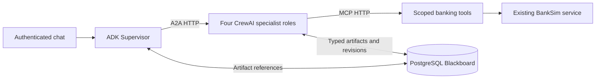

# BankAI

A local, fictional banking assistant and private agent-evaluation workspace.
Main architecture: **5 total agents**, including Supervisor. Evaluation
variants: **2, 3, and 5 total agents**, using the same banking capabilities.

## Current checkpoint

Phases 0–7 and 8A: a working local banking web application with JWT login,
dashboard, accounts, filtered transactions, cards, demo loans and support.
It uses the seeded PostgreSQL records and confirmed banking APIs.
Plan 2 Phase 5 now adds authenticated text chat, saved conversations, and a
direct Gemini SDK adapter with Pydantic responses. Live model verification passed
with the configured local provider. Phase 6 adds an ADK supervisor, four CrewAI
specialists, A2A, MCP tools and a shared PostgreSQL Blackboard. Phase 7 adds
fictional policy retrieval and validated source citations. Phase 8A adds browser
voice through LiveKit and dedicated speech conversion. Phase 8B now includes
local Plivo and Twilio phone-test integrations; multi-turn phone acceptance remains open.
Phase 9 now has a 60-case benchmark manifest and a private owner evaluation lab
for saved plans, run evidence, comparison, review and exports. The owner can also
type a question in Text assistant and explicitly run a 2/3/5-agent comparison
against their signed-in fictional account. Provider-backed comparisons require
live enablement and a cost acknowledgement. Active implementation follows
[Implementation Plan 2](BankAI_Implementation_Plan_2.md); the original plans are preserved.
The phone test lets the configured owner start an approved call so the
professor/recipient can speak with BankAI on a normal phone. Plivo credentials,
a public HTTPS callback and a live approved test are required to complete 8B.
See [implementation status](docs/IMPLEMENTATION_STATUS.md).

## Private evaluation lab (Plan 2 Phase 9)

The simple path is **Text assistant → type a question → acknowledge possible
model charges → Compare 2/3/5 agents**. The same question runs once for each
agent count using the signed-in demo customer's fictional records. The page
shows each answer, token counts, time, model/tool calls, roles used and estimated
token cost. Evaluation lab shows the same saved text comparisons; fixed pilot
and benchmark controls are under **Advanced fixed-question benchmarks**. This
does not run from phone calls and does not automatically launch paid runs.
Text comparisons pause 65 seconds between agent counts by default to reduce
free-tier request bursts. Set `EVALUATION_CELL_COOLDOWN_SECONDS=0` in the ignored
`.env` only when the provider quota supports faster runs.

The configured evaluation owner (or existing phone owner) can open **Evaluation
lab** to preview or save a plan with 2, 3 and 5 agents, Blackboard or direct
messages, ReAct or few-shot prompts, one to three repeats, and a hard cap on
attempts. Previewing and saving never call Gemini. The pilot has seven cases;
the benchmark has 60 cases and its full three-repeat design has 900 attempts.
The page can reopen saved runs, compare actual answers side by side, inspect
traces and artifacts, record human quality scores, and export JSON, CSV or
Markdown. Token-cost estimates require a dated price snapshot supplied by the
owner; absent usage is shown as unavailable, not zero.

The ignored `.env` keeps `EVALUATION_LIVE_ENABLED=false` by default. No paid
evaluation has been run. Later, a provider-backed run requires an explicit
owner start action, cost acknowledgement, the saved attempt cap, a dated price
snapshot, and the optional `evaluation-worker` Compose profile. A worker
restart marks an in-flight job interrupted, requiring manual review and resume
to avoid silently repeating a charged attempt. Apply migration `0010` before
using the lab. The real-provider pilot, human scoring, budget estimate and
final repeated benchmark remain Phase 9 exit checks.

## Text assistant setup (Plan 2 Phase 5)

Update the ignored root `.env` on the backend only:

```dotenv
LLM_PROVIDER=gemini
LLM_API_KEY=your-provider-key
LLM_MODEL=your-supported-model-id
LLM_TIMEOUT_SECONDS=30
LLM_MAX_OUTPUT_TOKENS=1024
```

Use a model available to your Google Gemini API project that supports structured
JSON output. Placeholder values above are not working credentials. The adapter
uses the [official Google Gen AI SDK](https://github.com/googleapis/python-genai)
directly; no agent framework is added in this phase. Other providers are not yet
implemented. Installing the updated backend dependencies and running
`python -m alembic upgrade head` adds the conversation tables without resetting
banking data. Restart the backend after changing configuration. For Docker, run
the migration with `docker compose exec backend python -m alembic upgrade head`
and recreate the backend after environment changes.

Sign in and open **Text assistant**, then start a conversation. You can reopen
saved conversations and inspect structured response details. Model calls send
the current question and the latest ten exchanges to the configured provider;
do not enter real credentials or personal information. History is stored in the
local database and isolated by customer. The list pages through 50 conversations
at a time, with at most 100 exchanges per conversation and 2,000 characters per question.

In `CHAT_MODE=guidance`, the Phase 5 flow provides general AI-generated guidance
only, without account tools or banking actions. `CHAT_MODE=agents` enables the
Phase 6 workflow below, with Phase 7 policy retrieval when configured and ingested.
Missing configuration produces a visible unavailable state and API 503; it never
silently returns a fake AI answer. Configured status checks the settings, not
provider reachability or available credit.

The API provides `GET /api/v1/chat/status`, `GET/POST /api/v1/chat/conversations`,
`GET /api/v1/chat/conversations/{id}`, and `POST /api/v1/chat`. Posting a question
requires a conversation ID, a client-generated UUID `message_id`, and `message`.
Retrying the same ID/text reuses a committed response; a changed message with the
same ID is rejected. Concurrent sends to one conversation receive 409. On a
connection failure, check saved history before changing and resending the text.
A provider response followed by a server/database failure can still incur a charge
without a saved answer; this prototype cannot guarantee provider-level exactly-once billing.

Provider requests have one attempt and a configurable timeout. Generation is
limited to ten new requests per minute per customer per API process. This local
throttle is not a distributed deployment quota. Failed generations are not added
to chat context; sanitized failure audit records retain the request ID. Replies
save model/prompt version, run ID, duration, and provider-reported tokens, with
missing usage marked unavailable. Phase 6 adds agent tracing; cost comparisons
remain later work.

## Five-agent chat (Plan 2 Phase 6)

The main system has exactly five configured roles:

| Role | Framework | MCP banking capabilities |
|---|---|---|
| Supervisor | Google ADK | Routing, delegation and typed finalization; no direct banking permissions |
| Account | CrewAI | Accounts/KYC and recent transactions |
| Card | CrewAI | Card snapshot and a pending block request |
| Loan | CrewAI | Existing loans, EMI, demo eligibility and a pending application |
| Policy/Support | CrewAI | Ticket lookup/creation, general explanations and summaries |

Only relevant agents run for each question. All five participated in the live
multi-part acceptance workflow; configured roles and model-call counts are
different metrics. Automatic manager/planner/reasoning agents, specialist
delegation, memory and vendor tracing are disabled. No third agentic framework
is used.



Enable the workflow in the ignored root `.env`:

```dotenv
CHAT_MODE=agents
AGENT_BASE_URL=http://127.0.0.1:8000
AGENT_TIMEOUT_SECONDS=150
```

Keep the backend-only model configuration, install the updated dependencies,
apply `alembic upgrade head`, then rebuild/restart. The current local application
is enabled in agent mode. Set `CHAT_MODE=guidance` and restart/recreate the backend
to use Phase 5 without delegation. Historical messages remain readable.

Try: “Read my balances and KYC, list my cards, calculate an EMI for INR 12000 at
12% annual interest for 12 months, and summarize the results.” Account artifacts
can feed Loan, and Support can consume specialist outputs. Open **Agent activity
and shared context** to inspect ordered callbacks, protocol events and Blackboard
artifacts. **Response details** shows validated JSON facts, provenance IDs,
model/prompt version, duration and usage.

Card blocking and loan applications produce pending actions. Select **Review
action**, check the server-bound details, then use **Confirm action**. Chat text
such as “yes” cannot confirm an action. Cancelling the dialog leaves the bank
record unchanged. Support tickets can be created when explicitly requested.
Phase 7 adds the approved fictional policy corpus described below.

A2A Agent Cards/endpoints under `/internal/a2a/{role}/` and MCP `/internal/mcp/`
require short-lived customer/run/role-bound grants. Customer JWTs cannot call
them directly. Tools reuse existing ownership checks and banking services. Agent
Cards must match the allowed internal endpoint. `GET /api/v1/chat/runs/{id}` and
`POST /api/v1/chat/runs/{id}/cancel` require ownership. Cancellation blocks future
tool/state access; an already running external request may still finish and incur
usage. PostgreSQL keeps durable evidence; transient A2A tasks are grant-scoped,
expire, and are capped at 1,000 per specialist endpoint.

Limits: 20 model calls, 16 unique successful tool executions, a 150-second default
deadline, two concurrent workflows per API process, and one specialist-output
repair. Matching tool calls within a run reuse receipts; completed specialist
delegations reuse artifacts. Confirmation replay remains protected by the banking
service. Failed runs may leave unconfirmed pending requests that expire normally;
automatic durable recovery and exactly-once provider billing are not implemented.

Tested versions: Google ADK 2.12.0, CrewAI 1.15.28, A2A SDK 0.3.26, MCP 1.28.1,
and Google Gen AI SDK 2.31.0. CrewAI's supported `BaseLLM` adapter reuses the shared
Google SDK instead of its incompatible optional provider-extra pin. The ADK agent
uses the official A2A client through its delegation tool; protocol adapters and
the typed finalization tool are not extra agents. FastAPI, Pydantic and tracing
dependency pins were resolved together and regression tested. Framework `.env`
auto-loading and vendor telemetry are disabled; Pydantic Settings owns
configuration, while application callbacks store redacted events in PostgreSQL.
Docker caches dependencies separately from source edits.

Prompt checks are heuristic and do not replace authorization, schema validation
or confirmation. Broader adversarial/performance comparisons, 2/3-agent variants,
alternate architectures/prompts, voice/phone calls, distributed quotas and cloud
hardening remain later Plan 2 phases. See [testing](docs/TESTING.md).

## Policy answers and citations (Plan 2 Phase 7)

The Support specialist now calls `search_policies` through authenticated MCP.
Three checked-in fictional policies contain ten named sections covering loan
eligibility/documents/EMI/confirmation, cards, accounts/KYC, and support. These are
educational BankSim rules, not a real bank's published terms. The document
requirements explicitly prohibit uploading real identity documents.

Configure the ignored backend `.env`:

```dotenv
CHAT_MODE=agents
EMBEDDING_PROVIDER=gemini
EMBEDDING_MODEL=gemini-embedding-001
EMBEDDING_API_KEY=
```

A blank embedding key reuses `LLM_API_KEY`; both stay backend-only. Restart the
backend after configuration changes. The direct Google SDK uses
[document/query task types](https://ai.google.dev/gemini-api/docs/embeddings)
and normalized 768-dimensional embeddings. No new agent or framework is added.

Ingest explicitly after the database is ready, from `backend`:

```powershell
.\.venv\Scripts\python.exe -m app.services.policies
```

Or, with Docker running:

```powershell
docker compose exec backend python -m app.services.policies
```

Ingestion makes provider calls only for new/changed sections; an unchanged repeat
embeds zero chunks. It is never run on startup or from a customer endpoint. Old
source versions remain stored, while retrieval accepts only the current approved
filenames/checksums and matching chunk text/model/dimensions. Existing banking
records and historical chat citations are preserved. No schema migration or new
dependency is needed beyond Phase 6.

Try **Text assistant**: “Which documents are required for a demo personal loan?”
or “What are the demo loan eligibility rules?” Expand **Fictional policy sources**
to inspect the cited section, exact excerpt, source filename and checksum. The
run timeline includes `retrieval_result`, MCP and Blackboard events. Final
`sources` are assembled from authenticated tool receipts; invented citation IDs
and an answered policy response without retrieval evidence are rejected.

Search uses exact pgvector cosine distance, a fixed 0.60 similarity cutoff, and
at most four sections. Missing matches return `missing`; different texts with
the same section name return `conflict`, requiring clarification or `needs_tools`
rather than a chosen policy. Missing configuration/index, tampered text, and
provider failures fail safely. Arbitrary uploads, private customer documents,
external URLs, and older source versions are not searched.

Limits: source selection and answer entailment still need quality evaluation;
similarity is not a correctness guarantee. Conflict detection uses matching
section names and does not detect every semantic contradiction. Injection
screening is heuristic; retrieved text cannot change deterministic authorization
or confirmation rules. Displayed token totals count generative model tokens;
embedding usage is recorded separately in retrieval/tool events when available,
otherwise `null`. No embedding cost or benchmark result is fabricated.

## Browser voice (Plan 2 Phase 8A)

Voice is another channel for the existing five banking agents; no LiveKit Agents
framework or additional banking agent is introduced. The raw LiveKit RTC/API
SDKs carry microphone and answer audio. Dedicated Gemini models perform verbatim
transcription and read the validated banking response aloud. Speech conversion
has no banking tools or authority. The same authenticated `/chat` endpoint saves
transcripts, answers, sources, pending actions and run traces.

Configure the ignored backend `.env`, then restart the backend:

```dotenv
VOICE_ENABLED=true
CHAT_MODE=agents
LIVEKIT_URL=ws://localhost:7880
LIVEKIT_INTERNAL_URL=ws://livekit:7880
LIVEKIT_NODE_IP=your-host-LAN-IPv4
LIVEKIT_API_KEY=your-local-or-cloud-key
LIVEKIT_API_SECRET=your-local-or-cloud-secret
STT_PROVIDER=gemini
STT_API_KEY=
STT_MODEL=gemini-3.5-transcribe
TTS_PROVIDER=gemini
TTS_API_KEY=
TTS_MODEL=gemini-3.8-flash-lite-tts
```

Blank speech keys reuse `LLM_API_KEY` on the backend. Generate a random local
LiveKit secret (for example `python -c "import secrets; print(secrets.token_urlsafe(32))"`);
never commit it. For LiveKit Cloud, use the project's `wss://` URL for both URL
settings and skip the local LiveKit container. These credentials are different
from the Google key. No service signup or paid subscription is created by setup.

For the local Docker transport, set NODE_IP to the host IPv4 reachable from both
the browser and Docker (PowerShell `Get-NetIPConfiguration`). The local profile
maps media TCP 7881 and UDP 7882, while signaling 7880 is loopback-only. Update
NODE_IP after changing networks. This local development profile is not a cloud
deployment; use a properly secured LiveKit host or Cloud for remote users.

```powershell
docker compose build backend frontend
docker compose --profile voice up -d db livekit
docker compose run --rm --no-deps backend python -m alembic upgrade head
docker compose --profile voice up -d
```

Apply migration `0006` before enabling voice on an existing deployment. If running
the backend directly on Windows rather than Docker, use
`LIVEKIT_INTERNAL_URL=ws://localhost:7880`. API startup closes stale database
voice sessions; the current implementation supports one API process, two active
voice sessions globally and one per customer. No old session recording resumes.

Sign in, open **Text assistant**, and select or start a conversation. Click
**Start browser voice**, allow microphone access, then **Speak question** and
**Send voice question**. Questions are explicitly segmented rather than using
automatic voice-activity detection. The microphone is muted outside recording.
**Stop playback or discard speech** suppresses the current audio response;
**End voice session** stops the microphone and disconnects the room. A session
lasts at most five minutes/eight questions, with at most 30 seconds per recording.
HTTPS or localhost and a WebRTC-capable browser are required.

Voice answers appear in the ordinary conversation with policy citations and the
existing action-review dialogs. Saying “yes” never confirms a card block or loan
submission; use the exact protected UI confirmation. Audio buffers are transient;
no customer audio recording is stored. Transcripts and answers remain in the
owner's chat history. Room grants are short-lived and scoped to one random room
and identity, microphone publishing and subscription. Customer/run/session IDs
correlate speech events with the banking trace; API bearer tokens stay in worker
memory and are never sent as LiveKit metadata or model content.

Speech events record conversion models, usage where available, duration, errors,
interruptions and final banking run IDs. **Speech activity** exposes this evidence.
Generative banking tokens, transcription tokens and speech-generation tokens are
separate; no billing amount is invented. Browser recording/playback, live
conversion and the agent workflow introduce noticeable latency. Cancellation can
suppress playback but cannot guarantee cancellation of an already submitted
provider/banking request or its charges. Check saved history before retrying.
No automatic replay/reconnect is performed. If TTS fails, the saved text remains.

## Phone test (Plan 2 Phase 8B, local integration)

The owner-only phone panel uses Plivo Voice or Twilio Programmable Voice to call an approved
number. The selected provider gathers speech and reads the answer; the question still goes
through the same authenticated five-agent chat in a separate selected fictional
customer conversation. The owner can read those turns in the phone panel. This
path does not need a LiveKit SIP trunk. Browser voice continues
to use LiveKit and Gemini STT/TTS. Sarvam is not integrated.

Create a **separate owner account** at `http://localhost:8000/docs`: open
`POST /api/v1/auth/register`, choose **Try it out**, and submit a name, email,
and password of at least 12 characters. Copy the `id` from its response into
`PHONE_OWNER_CUSTOMER_ID`, then sign in to the web app with that account. Do
not use a seeded `demo.*@bankai.example` account for outbound calls. To give
the owner a separate fictional banking profile, run
`docker compose exec backend python -m app.seed.owner_demo` after migrations.
This adds two accounts, six transactions, two cards, a draft loan and a support
ticket without changing existing owner records; rerunning it is safe. The
phone panel's **My fictional demo account** option uses this same profile.
Set these
values in the ignored root `.env` (never commit them):

```dotenv
PHONE_ENABLED=true
PHONE_PROVIDER=plivo
PHONE_OWNER_CUSTOMER_ID=owner-UUID-from-auth-me
PLIVO_AUTH_ID=your-Plivo-auth-ID
PLIVO_AUTH_TOKEN=your-Plivo-auth-token
PHONE_PUBLIC_BASE_URL=https://your-public-backend-host
PHONE_CALLER_NUMBER=your-voice-enabled-Plivo-number-in-E164
PHONE_ALLOWED_NUMBERS=the-consenting-verified-recipient-in-E164
PHONE_MAX_DURATION_SECONDS=300
```

The public URL must forward HTTPS POST requests to this backend, preserving the
original path and query string. The provider signs the callback against that exact
public URL. A localhost URL cannot receive a call webhook. Check
`https://your-public-backend-host/ready` in a browser before calling; it must
return `{"status":"ready"}`. If ngrok reports `ERR_NGROK_3200`, restart the
tunnel with `ngrok http 8000`, update `PHONE_PUBLIC_BASE_URL` if its HTTPS address
changed, and recreate the backend. BankAI now rejects a call before dialing when
this public readiness check fails. Apply migrations,
restart the backend, and sign in as the configured owner. The Text
assistant then shows **Phone test with Plivo**. Confirm the recipient agreed,
select the allowlisted number and fictional customer, and start the call. The recipient hears the
fictional-demo disclosure, presses **1** to agree, and can ask up to three
questions. Banking action confirmations remain in the web app.

The backend allows one active call, at most four attempts per UTC day, and up to
five minutes per call. It does not redial or record audio; only masked number
suffixes, status events, and consented chat transcripts are saved locally.
The provider may store its own call metadata under your account. End call is available
in the owner panel. Plivo trial calling requires a verified sandbox destination and an approved
voice-enabled caller number. For Twilio, set `PHONE_PROVIDER=twilio`, use
`TWILIO_ACCOUNT_SID` and `TWILIO_AUTH_TOKEN` instead of the Plivo credentials, and
use a Twilio caller number. Twilio's current trial outbound Call API requires a Twilio
sample voice URL; BankAI sends its own URL for the five-agent conversation, so
this outbound path requires an account that permits custom call instructions.
The [Voice trial rules](https://www.twilio.com/docs/usage/trials/try-out-voice)
also restrict recipient verification and calling geography. A trial account
returned HTTP 400 on the first live dial attempt; no call was connected or
conversation verified. Provider-free callback tests do not satisfy the phone
exit gate.

## Prerequisites

- Python 3.11+
- Node.js 22.12+ and npm
- Docker Desktop running Linux containers (or local PostgreSQL 16 with pgvector)
- Available local ports 55432, 8000, 5173 (PostgreSQL uses 55432 on the
  host to avoid interfering with an existing local PostgreSQL service)

## Local setup (PowerShell)

From the project root, set up local configuration with the helper below.
It generates a signing key without printing it and refuses to overwrite an
existing `.env`. Never put real banking information in this project.

```powershell
docker compose up -d db
cd backend
python -m venv .venv
.\.venv\Scripts\python.exe -m pip install -c requirements-dev.lock.txt -e '.[dev]'
.\.venv\Scripts\python.exe -m app.core.setup_local
.\.venv\Scripts\python.exe -m alembic upgrade head
.\.venv\Scripts\python.exe -m app.seed.demo_data
.\.venv\Scripts\python.exe -m uvicorn app.main:app --host 127.0.0.1 --port 8000
```

In a second terminal, from the project root:

```powershell
cd frontend
npm.cmd ci
npm.cmd run dev
```

Open http://localhost:5173. API docs: http://127.0.0.1:8000/docs.
Sign in with a fictional demo customer, then use the sidebar to navigate.
The current tab retains its session across refresh until token expiry or
sign-out. A 401 returns to login and clears displayed customer data. Closing
the tab ends its browser session; passwords are not stored. Sign-out clears
the browser token but does not revoke a separately copied JWT server-side.
`/health` reports process status. `/ready` returns 200 only when a real
database query succeeds, otherwise a sanitized 503 with request ID.
The Vite dev proxy forwards frontend `/api/health` and `/api/ready` to
the backend. Banking routes require a Bearer token; infrastructure checks
remain public. If `.env` already exists, preserve it and configure a random
`APP_SECRET_KEY` of at least 32 characters. The supplied placeholder is
rejected; missing/placeholder keys disable authentication with HTTP 503.

## Docker alternative

```powershell
docker compose up --build -d
docker compose ps
```

This is local development, with ports bound to loopback and a Vite dev
server. It is not a production deployment. PostgreSQL data persists in
the `bankai_data` volume. `infra/init.sql` enables pgvector on first startup.
Compose loads the ignored root `.env` for backend authentication and overrides
its database host with the internal `db` service. Prepare `.env` first.

## Checks

```powershell
cd backend
$env:BANKAI_RUN_DB_TESTS='1'
.\.venv\Scripts\python.exe -m pytest -q
.\.venv\Scripts\python.exe -m ruff check app tests
cd ../frontend
npm.cmd test
npm.cmd run build
```

See [testing](docs/TESTING.md) for verified results and limitations.
The frontend lockfile and Python constraints record the versions used
at this checkpoint. If npm 10 encounters an `edgesOut` error while
changing dependencies, use a temporary npm 11 invocation; do not force
dependency upgrades or disable peer checks.

## Shutdown and troubleshooting

Stop local servers with Ctrl+C. From the root, `docker compose stop`
stops containers while retaining data; `docker compose down` removes
containers/network while retaining the database volume. Do not delete
the volume to solve an ordinary connection error.

- Docker pipe/daemon error: start Docker Desktop and wait for the engine.
- Port already used: stop the conflicting service or adjust both Compose
  and `DATABASE_URL` / proxy settings consistently.
- Backend connected, database unavailable: check `docker compose ps` and
  `docker compose logs db`; confirm database connection settings locally.
- Backend unavailable: start Uvicorn on port 8000, then refresh status.
- PowerShell script restrictions: use `npm.cmd` and the virtual environment's
  Python executable; activation is unnecessary.

## Demo database (Phase 2)

Run migration and seed commands from `backend` as shown above. Migration
`0001` creates ten application tables and enables pgvector. Seeds include
3 customers, 4 accounts, 20 transactions, 4 cards, 3 KYC records, 3 loans,
3 support tickets, 1 audit event, and 1 synthetic policy with 1 chunk.
Money is stored as exact decimals, timestamps include timezone, and
transaction totals match the initial account balances.

For local development only, the fictional emails are
`demo.asha@bankai.example`, `demo.ravi@bankai.example`, and
`demo.mira@bankai.example`. Their shared demo password is
`BankAI-demo-only-2026!`, stored in PostgreSQL only as salted Argon2 hashes.
Login now works through `/api/v1/auth/login`. These are not production credentials.

Repeat seeding safely: existing IDs, passwords, balances and card states
are preserved. A repeated unchanged seed reports zero inserted records.
There is no destructive reset command. Test fixtures are disposable; do
not downgrade or delete the demo database to rerun seeds. Local seed CLI
rejects remote hosts and non-development mode. This guard is not a
replacement for future authentication.

Docker backend images now include the migration tooling and mount the
sample corpus read-only. After starting Compose:

```powershell
docker compose exec backend python -m alembic upgrade head
docker compose exec backend python -m app.seed.demo_data
```

Policy storage is prepared, but embeddings remain NULL until the RAG
phase configures a provider. No fabricated embeddings are seeded.
Provider adapters and voice setup will be added in their phases. No
provider keys are required for Phase 2; blank values are not integrations.
## Try the banking web application (Phase 4)

- Dashboard shows balances and recent activity fetched from the backend.
- Accounts includes an account selector and balance refresh.
- Transactions supports account/type/status/date/amount filters, previous/next
  paging, and a clearly labelled search of the current page.
- Cards stages a block request, then shows the exact card in a confirmation
  dialog. Cancel dismisses the dialog without executing; the server's pending
  request expires automatically. No backend cancellation endpoint exists yet.
- Loans provides API-backed EMI, demo eligibility and confirmed applications.
- Support creates tickets and shows the customer's saved history and details.

Loading, empty and error states include retry for reads. Writes are never
retried automatically. After an interrupted write, refresh the relevant
records to verify its outcome before manually repeating it. Demo changes
persist; seed reruns do not reset them. AI/evaluation features are marked as
future work in About and are not simulated as working UI features.

## Try Phase 3 APIs directly

Start the backend, open `http://127.0.0.1:8000/docs`, and call
`POST /api/v1/auth/login` with a demo email and password. Copy the returned
access token into Swagger's **Authorize** Bearer field. Do not put tokens
in source files or share them. Tokens expire after 30 minutes by default.

- `GET /api/v1/accounts`, `/cards`, `/loans`, `/kyc/status` and `/support/tickets`
  return only the authenticated customer's fictional records.
- `GET /api/v1/transactions` supports `limit`, integer `cursor`, `account_id`,
  `transaction_type`, `status`, date and amount filters.
- `POST /api/v1/cards/{card_id}/block` returns HTTP 202 and a pending action.
  It does not change card status. Confirm at `/cards/{card_id}/block/confirm`
  with `{ "action_id": "returned-uuid", "confirmation": true }`.
- `POST /api/v1/loans/applications` stages validated demo inputs. Confirm at
  `/loans/applications/{action_id}/confirm` with `{ "confirmation": true }`.
- A pending action expires after 5 minutes. Expired, reused, mismatched or
  another user's confirmations cannot execute. Replays return 409, not a second write.
- `POST /api/v1/support/tickets` creates an open demo ticket from an explicit request.

See [API details and example bodies](docs/API_SPEC.md). No real transfers,
credit decisions, identity document collection, or external bank connections exist.

## Documentation

### Phase 9 evaluation pilot

With the local PostgreSQL service running and the backend virtual environment
installed, inspect the seven synthetic cases and five comparison cells without
calling the model:

```powershell
cd backend
.\.venv\Scripts\python.exe evals/run_comparison.py
```

An explicit provider pilot can run one case and one cell, for example
`--live --case loan-emi-fixed --cell 5 --max-attempts 1`. This can consume
Gemini credits. It creates and removes an isolated synthetic database schema
and writes its exploratory result to a unique ignored `.artifacts/phase9-pilot-*.json` file.
The preliminary score checks saved receipts; a person must review answer
quality. The complete 60-case benchmark and evaluation dashboard are pending.

- [Implementation plan](docs/IMPLEMENTATION_PLAN.md)
- [Architecture](docs/ARCHITECTURE.md)
- [API](docs/API_SPEC.md)
- [Security](docs/SECURITY.md)
- [Demo guide](docs/DEMO_GUIDE.md)

Implementation references: [Vite](https://vite.dev/guide/),
[Tailwind Vite integration](https://tailwindcss.com/docs/installation/using-vite),
and [FastAPI containers](https://fastapi.tiangolo.com/deployment/docker/).
