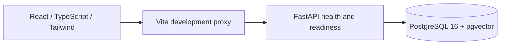

# Architecture

## Implemented: foundation

`/health` checks process liveness independently of the database. `/ready`
performs SELECT 1 with bounded connection/query waits. Startup does not
create tables or silently substitute a different database. Frontend
shows only measured service status and labels future capabilities planned.

## Planned trust boundaries

Authentication supplies identity to services. Supervisor routes to
Account, Card, Loan, or combined Policy/Support: five total agents.
Typed tools call ownership-checking services; no LLM or browser gets
database access. RAG and voice are shared adapters, not additional agents.

Private evaluation pages call owner-only APIs. A PostgreSQL-backed job
worker invokes the same graph factory with 2/3/5 roles. Mutable evaluation
fixtures live separately from demo banking data and persistent results.
All variants share authorization, action confirmation and scoring rules.
This architecture is planned; none of these protected workflows exist yet.

## Decisions

- One Python backend and one React app; no microservices for individual agents.
- Local development first; no hosted Sites publication.
- PostgreSQL/pgvector retained as specified, with no SQLite fallback.
- PostgreSQL publishes host port 55432 (container port 5432), because an
  existing local service already occupies 5432. Its data/services were not modified.
- Provider packages will be added in the phases that require them.
- Vite 6 / React 19 / Tailwind 4 used as a compatible foundation; exact
  frontend resolution is captured in package-lock.json.
- Vitest 4.1.11 resolves the initially detected test-tool advisories.
  Python versions are captured in requirements-dev.lock.txt constraints.
