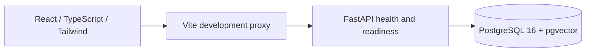

# Architecture

## Implemented: foundation

`/health` checks process liveness independently of the database. `/ready`
performs SELECT 1 with bounded connection/query waits. Startup does not
create tables or silently substitute a different database. Frontend
shows only measured service status and labels future capabilities planned.

## Implemented: Phase 2 persistence

Customers own accounts, cards, one KYC record, loans and support tickets.
Accounts own transactions; cards optionally reference an account using a
composite `(account_id, customer_id)` foreign key. Policy documents own
chunks. Audit rows reference an optional customer and carry action/resource
metadata without conversation text or secrets. These are ten application
tables plus Alembic's version table.

Money uses NUMERIC(18,2); rates use NUMERIC(7,4). SQLAlchemy timestamps
are timezone-aware. Updated timestamps are maintained on ORM updates;
there is no raw-SQL timestamp trigger. Customer emails must be lowercase
and unique. Deletion is restricted by foreign keys; destructive cascading
banking-record deletion is not enabled.

Policy embeddings use nullable, dimension-flexible pgvector values with
embedding-model metadata. Provider-specific dimensions, validation and a
similarity index will be selected in Phase 7, once the embedding model is
known. No vector index or retrieval capability is claimed in this phase.

Alembic revisions contain explicit schema operations independent of mutable
application metadata. Application startup never auto-creates tables. Seed
data has stable UUIDs, exact decimal amounts, fixed timestamps, insert-only
conflict handling and a transaction lock. Reruns do not reset interactive
changes. Synthetic policy versions use a content checksum.

References: [SQLAlchemy constraints](https://docs.sqlalchemy.org/en/20/core/constraints.html)
and [Alembic migrations](https://alembic.sqlalchemy.org/en/latest/tutorial.html).

## Implemented: Phase 3 API and transactions

FastAPI dependencies validate a Bearer JWT and load an active customer.
BankingService receives that trusted customer ID, never one from a request
body. Ownership-scoped queries return a consistent 404 for missing/foreign
resources. Schemas reject extra fields and bound amounts, rates and tenure.

Migration `0002` adds pending_actions, bringing the schema to eleven
application tables. Pending card/loan operations store owner, bound inputs,
expiry and execution state. Confirmation locks the customer and pending
action, then checks current card or KYC state. Consumed action, result and
success audit are committed atomically. Failed operations roll back first,
then persist a denial audit. The request-scoped session commits before a
successful HTTP response is sent.

Password hashes use Argon2. Access tokens use HS256 with a private local
signing key, explicit issuer/audience and required claims. Process-local
login throttling is intentionally limited to the current local deployment.

## Implemented: Phase 4 banking frontend

React uses native hash navigation for seven pages (dashboard, accounts,
transactions, cards, loans, support and about), without a routing dependency.
A shared fetch function attaches the Bearer token, bounds requests to ten
seconds, and surfaces sanitized backend errors/request references. Resource
loads abort on navigation and ignore stale results. Write handlers lock
submissions and retain form input when a request fails.

The tab stores token/expiry in sessionStorage, reloads `/auth/me` on restore,
and clears the entire authenticated workspace on sign-out, expiry or 401.
Customer data is fetched afresh rather than stored in browser persistence.
All amounts and action results come from the existing BankSim API. Native
modal dialogs display exact pending action details and send explicit true
only after the user confirms. Cancel is a local dismissal; pending actions
expire on the server. AI/voice/evaluation interfaces remain future phases.

## Planned agent and evaluation workflows (later phases)

Authentication supplies identity to services. Supervisor routes to
Account, Card, Loan, or combined Policy/Support: five total agents.
Typed tools call ownership-checking services; no LLM or browser gets
database access. RAG and voice are shared adapters, not additional agents.

Private evaluation pages call owner-only APIs. A PostgreSQL-backed job
worker invokes the same graph factory with 2/3/5 roles. Mutable evaluation
fixtures live separately from demo banking data and persistent results.
All variants share authorization, action confirmation and scoring rules.
Agent routing and evaluation architecture are planned; the authenticated
banking service and confirmation logic they will reuse are implemented.

## Decisions

- One Python backend and one React app; no microservices for individual agents.
- Local development first; no hosted Sites publication.
- PostgreSQL/pgvector retained as specified, with no SQLite fallback.
- PostgreSQL publishes host port 55432 (container port 5432), because an
  existing local service already occupies 5432. Its data/services were not modified.
- Provider packages will be added in the phases that require them.
- Vite 6 / React 19 / Tailwind 4 used as a compatible foundation; exact
  frontend resolution is captured in package-lock.json.
- Vitest 4.1.11 resolves the initially detected test-tool advisories.
  Python versions are captured in requirements-dev.lock.txt constraints.
